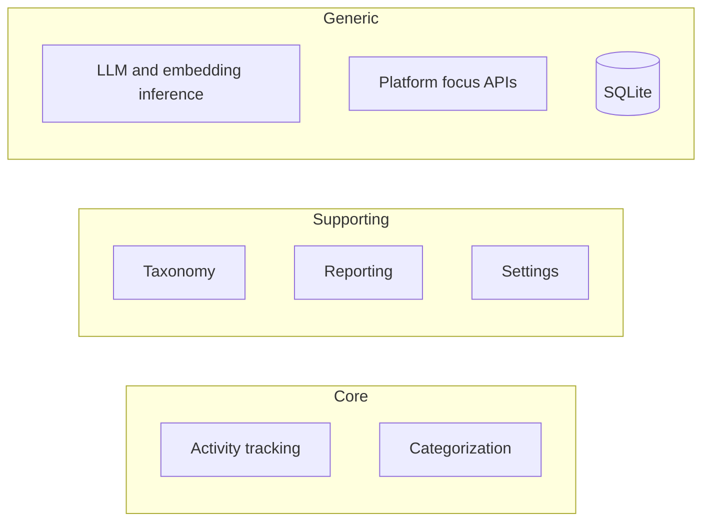
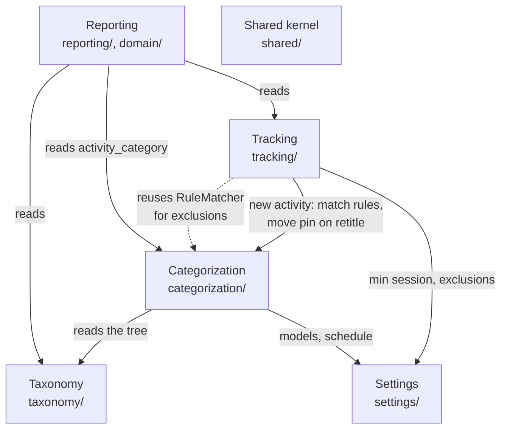
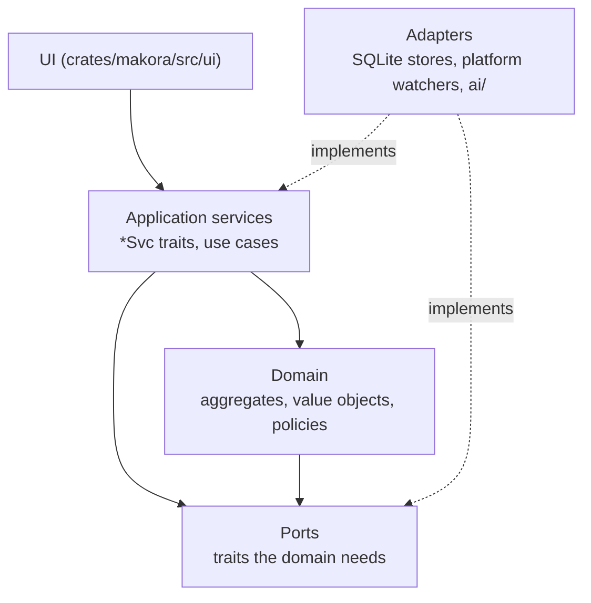
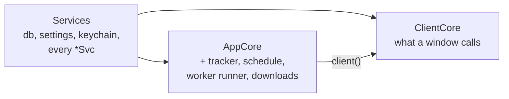

# Architecture

Makora is a local time tracker. It watches which app (and which browser tab) has focus, records one row per block of activity, and files each activity under a category: by the person's hand, by a rule they wrote, or by an AI suggestion they review. Everything is stored in one SQLite file on the machine.

These pages describe the system the way Domain-Driven Design does: first the problem space (subdomains and the language used to talk about them), then the solution space (bounded contexts, their aggregates and how they talk to each other), then the infrastructure that runs it.

| Page                                       | What it covers                                                        |
| ------------------------------------------ | --------------------------------------------------------------------- |
| [Ubiquitous language](ubiquitous-language.md) | The words the code, the UI and these docs share                     |
| [Tracking](tracking.md)                    | Turning focus changes into sessions and activities                    |
| [Categorization](categorization.md)        | Pins, rules and AI suggestions, and the AI run                        |
| [Taxonomy and Settings](supporting-contexts.md) | The category tree, preferences and AI providers                  |
| [Reporting](reporting.md)                  | The read models behind history, statistics and review                 |
| [Processes and IPC](processes.md)          | The background, window and worker processes                           |
| [Persistence](persistence.md)              | The SQLite schema and how each context owns its tables                |

## Subdomains

DDD separates the part of the problem that makes the product worth building (the core) from the parts every product of its kind needs (supporting) and the parts anyone could buy off the shelf (generic).

- **Activity tracking** (core). Recording time with no input from the person is the product. The hard parts are domain rules: what counts as the same activity, which blocks are noise, when a browser's time belongs to a site.
- **Categorization** (core). Raw time is only useful once it is filed. The rules for which decision wins (pin, rule, AI) and how the model learns from rejections are where most of the domain logic lives.
- **Taxonomy** (supporting). A tree of categories with a few invariants. Needed, but not what makes Makora different.
- **Reporting** (supporting). Statistics, habits and the history list. Read-only views over the core contexts.
- **Settings** (supporting). Preferences in a TOML file the person can also edit by hand.
- **Inference, platform APIs, storage** (generic). llama.cpp, remote LLM APIs, OS focus and presence APIs, SQLite. They sit behind ports so the domain never names them.

## Context map

Each core and supporting subdomain is a bounded context, a Rust module under `crates/makora-core/src/` with its own `domain`, `application`, `ports` and store modules.

The relationships, in DDD terms:

| Upstream → downstream          | Relationship         | How it shows in the code                                                                                                                   |
| ------------------------------ | -------------------- | ------------------------------------------------------------------------------------------------------------------------------------------ |
| Shared kernel → every context  | Shared kernel        | `shared::ids` (`ActivityId`, `CategoryId`, `SessionId`, …), `shared::time`, `shared::text`, and `tracking::domain::source_key`.             |
| Categorization → Tracking      | Conformist           | `tracking::domain::exclusion` parses exclusions with categorization's `RuleMatcher`, so a rule and an exclusion always agree on what `github.com/acme` covers. |
| Tracking → Categorization      | Customer / supplier  | When `tracking::store::ensure_activity` creates an activity it calls `categorization::rules_store::match_new` in the same transaction; a retitle moves the pin through `categorization::store`. |
| Taxonomy → Categorization      | Customer / supplier  | A run reads the category tree as the list of paths the model may answer with (`Work > Meetings`).                                           |
| Tracking, Categorization, Taxonomy → Reporting | Published language (SQL) | Reporting joins the `activity_category` view, the SQL form of the categorization precedence rules, and never re-derives a category. |
| AI infrastructure → Categorization | Anticorruption layer | `categorization::ports::{Classifier, Embedder}` are implemented in `ai/`; prompts, GGUF files, HTTP APIs and redaction never leak into the domain. |

All contexts run in one process and share one database, so integration is synchronous and transactional. There is no message bus between contexts. The only events that cross a boundary are `CoreEvent`s (`events.rs`), which tell the UI about background progress.

## Layers inside a context

- **Domain** (`*/domain/`): plain Rust with no I/O. `FocusStateMachine`, `ActivityClassification`, `RuleMatcher`, `CategoryTree`, `session_policy`. Unit tests live here.
- **Ports** (`*/ports.rs`): what the domain needs from outside: `SessionRecorder`, `ExclusionPolicy`, `Classifier`, `Embedder`.
- **Application** (`*/application*`): use cases as traits (`ClassificationSvc`, `RuleSvc`, `CategorySvc`, `SettingsSvc`, …) with a `Sqlite*` implementation that loads aggregates, calls the domain and saves the difference in one transaction.
- **Adapters**: Diesel stores (`*/store.rs`, `db/`), OS watchers (`tracking/adapters/platform/`), the browser bridge, and the AI infrastructure (`ai/`).

## Composition root

`crates/makora-core/src/app_core.rs` wires adapters to ports. It has three levels, so each process builds only what it needs.

- `Services::open` opens the database, `settings.toml` and the keychain and builds every application service. It starts no thread, so any process may open it.
- `AppCore::open` adds the tracker (`FocusStateMachine` over `SqliteSessionRecorder` and `SettingsExclusions`), the AI runner, the schedule and model downloads. `start_background` starts the watchers, the bridge listener and the schedule.
- `ClientCore` is the set of application traits the UI calls. In the window process its runner and downloads are proxies that ask the background process over IPC (see [Processes](processes.md)).
