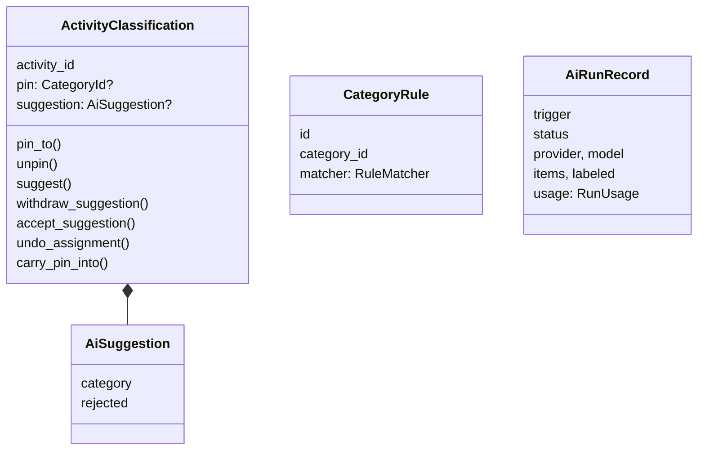
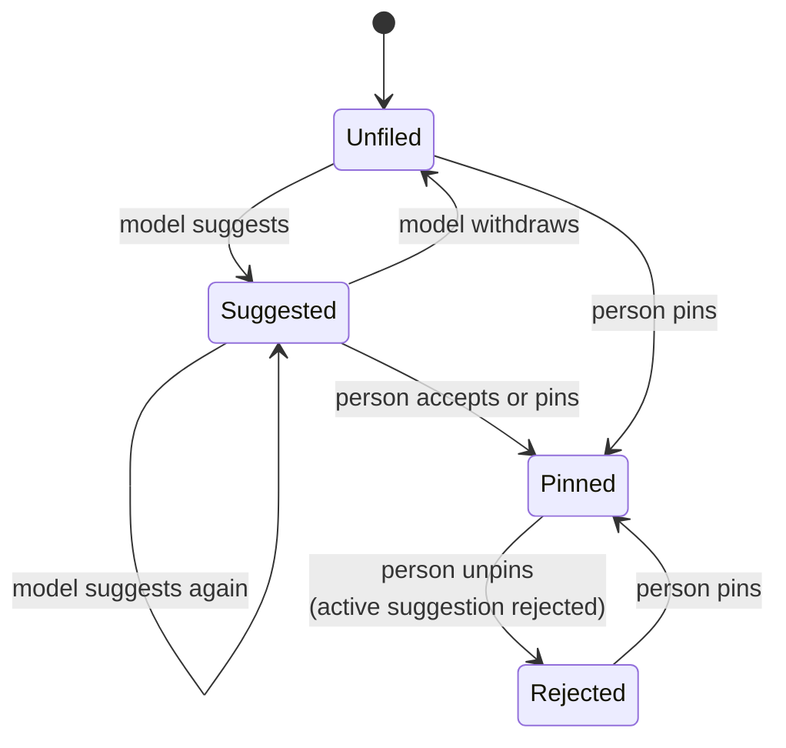
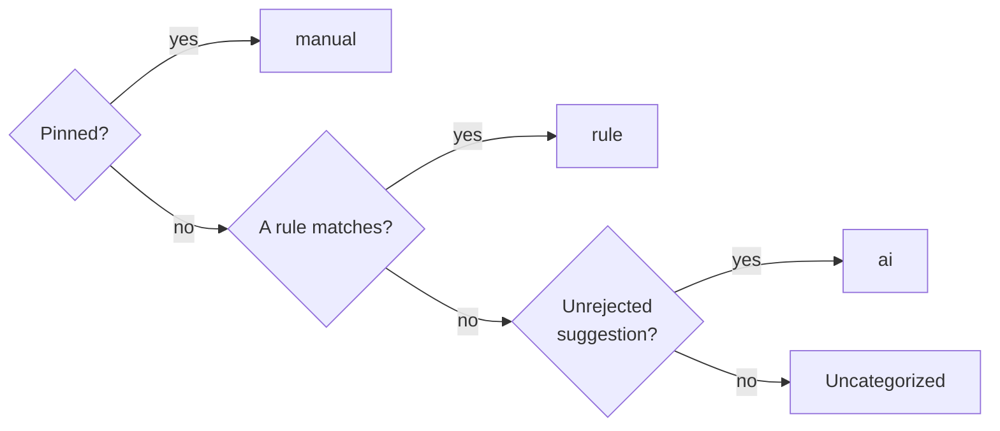
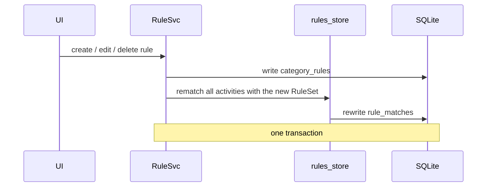
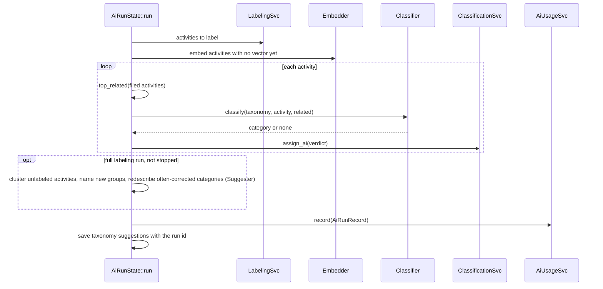
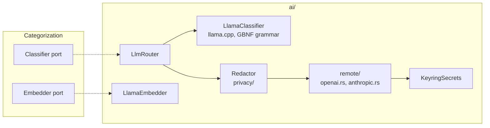

# Categorization context

`crates/makora-core/src/categorization/` (domain and use cases), `crates/makora-core/src/ai/` (inference infrastructure)

Categorization decides what category an activity is filed under, and why. Three actors can decide: the **person** (a pin), the person's **rules**, and the **model** (a suggestion). The context owns the precedence between them and the AI run that produces suggestions.

## Module layout

| Module                              | Layer        | Contents                                                                    |
| ----------------------------------- | ------------ | --------------------------------------------------------------------------- |
| `domain/classification.rs`          | Domain       | `ActivityClassification`, `AiSuggestion`, `PinConflict`                     |
| `domain/rules.rs`                   | Domain       | `RuleKind`, `RuleMatcher`, `RuleSet`, `ActivityFacts`, rule precedence      |
| `domain/retrieval.rs`               | Domain       | `activity_text`, `SourceRef`, `top_related` (nearest filed activities)      |
| `domain/usage.rs`                   | Domain       | `AiRunRecord`, `RunTrigger`, `RunStatus`                                    |
| `domain/clustering.rs`              | Domain       | `cluster`, `samples`: grouping unlabeled activities by embedding            |
| `domain/suggestions.rs`             | Domain       | `TaxonomySuggestion` and its payloads, `reconcile_new`                      |
| `ports.rs`                          | Ports        | `Classifier`, `Suggester`, `Embedder`, `LlmSpec`, `ActivityText`, `UsageMeter`, `RunUsage` |
| `application/pinning.rs`            | Application  | `ClassificationSvc`: assign, undo, accept, store verdicts, reset            |
| `application/rules.rs`              | Application  | `RuleSvc`: create, edit, delete, preview rules                              |
| `application/ai_run.rs`             | Application  | `AiRunState::run`: the AI run use case                                      |
| `application/runner.rs`             | Application  | `CategorizationRunner`: a run with the models the settings name             |
| `application/schedule.rs`           | Application  | `AutoCategorizeSchedule`, `ScheduleAnchor`                                  |
| `application/embeddings.rs`         | Application  | `EmbeddingSvc`, `embed_missing`                                             |
| `application/usage.rs`              | Application  | `AiUsageSvc`: the record of every run                                       |
| `application/suggestions.rs`        | Application  | `TaxonomySuggestionSvc`: list, accept, dismiss; `generate`                  |
| `store.rs`, `rules_store.rs`        | Adapter      | Loading and saving classifications; keeping `rule_matches` current          |

## Aggregates

- **`ActivityClassification`** is the aggregate root for one activity's filing. Every change to a pin or a suggestion goes through its methods, which enforce the invariants below. `ClassificationSvc` loads the classifications a use case concerns, calls the methods, and saves the difference in one transaction.
- **`CategoryRule`** is an entity (table `category_rules`) wrapping a `RuleMatcher` value object. Rules are evaluated together as a `RuleSet`.
- **`AiRunRecord`** is written once when a run ends, however it ends, and never changed.
- **`Embedding`** (a unit vector per activity, tagged with its model) is a value cached in `activity_embeddings`.

### Invariants of `ActivityClassification`

- A pin always wins over a suggestion.
- The model can never overwrite a pin: `suggest` and `withdraw_suggestion` on a pinned activity do nothing.
- Unpinning rejects the active suggestion, so "Uncategorized" sticks and the model learns from the rejection.
- A rejection belongs to the person: `withdraw_suggestion` leaves a rejected suggestion alone.
- Accepting a suggestion turns it into a pin; the suggestion stays as the record of what the model said.
- Merging two activities carries the pin across unless both have different pins (`PinConflict`).

## Precedence: how the resolved category is chosen

The same order exists in exactly two places: the domain (`classification.rs`, `rules.rs`) and its SQL form, the `activity_category` view (`db/migrations/0010_drop_ai_confidence.sql`). Every read in [Reporting](reporting.md) joins the view instead of recomputing it.

## Rules

A rule is one of four kinds, compared case-insensitively:

| Kind      | Matches                                        | Example            |
| --------- | ---------------------------------------------- | ------------------ |
| `app`     | An executable                                  | `code`             |
| `site`    | A domain                                       | `github.com`       |
| `page`    | A domain and a path prefix, by whole segments  | `github.com/acme`  |
| `pattern` | A `*`/`?` glob over the URL, title or app name | `*standup*`        |

When several match, the most specific wins: a page (longer path first), then an app or site, then a pattern (more literal text first). A tie goes to the oldest rule.

Rules are **retroactive**. The winning rule of every activity is stored in `rule_matches`, so reads never evaluate a rule.

A new activity from [Tracking](tracking.md) is matched on its own (`rules_store::match_new`) in the tracker's transaction.

### Rule suggestions

`domain/rule_mining.rs` mines the user's pins into **rule suggestions**, computed on demand by `RuleSvc::suggestions`. Only pins count as evidence. Unreviewed AI labels are what a rule would replace, and activity a rule already files adds no evidence.

- Candidates are an app, a site, or a page one or two path segments deep. A candidate qualifies with at least 5 activities and 30 minutes in its top category, and at least 90% of its pinned time there.
- A page is dropped when a site or shorter page above it qualifies for the same category.
- When an existing rule already files the candidate under that category, it is dropped. When a rule with the same matcher files it elsewhere, the suggestion becomes a change to that rule.
- A **dismissal** hides one (matcher, category) pair for good (`rule_suggestion_dismissals`). It is applied after pruning, so dismissing a site also hides its same-category pages.

Accepting a suggestion is an ordinary `create` or `update`, so it is retroactive, and pins keep precedence.

### Taxonomy suggestions

The taxonomy grows from the data. A **taxonomy suggestion** (`taxonomy_suggestions`) is a change to the categories the person accepts or dismisses.

- **New category.** The activities the model found no category for (`ai_unlabeled`, still unfiled) are clustered by embedding (`domain/clustering.rs`): greedy leader clustering, joining a leader at cosine ≥ 0.80, then merging leaders at ≥ 0.85. A group with at least 5 activities and 30 minutes is proposed, and the model names it through the `Suggester` port from 5 members, with a description and a parent; a group it cannot name is still proposed, unnamed. Points are taken in id order, so the same data always gives the same groups.
- **Matching earlier suggestions** (`reconcile_new`). Two groups are the same when they share half of the smaller one. A group that is mostly an accepted or dismissed suggestion is dropped; one that is mostly a pending suggestion updates its members and keeps its name, so it is not named again. At most 5 groups are named per run.
- **Sharper description.** The person's answers to a category's AI labels are counted over the activities seen in the last 30 days (`get_feedback_by_category`). A label is moved out when the activity was pinned to another category, or the label was rejected and no rule files the activity. A category with at least 5 moved out, and at least 30% of its reviewed labels, gets a new description from the model (`Suggester::describe_category`), shown 5 activities kept in it and 5 moved out with where they went. At most 3 per run; a category with a pending description suggestion, or one accepted or dismissed within 30 days, is skipped.
- **Merge.** Two categories are proposed for a merge when the centroids of their filed activities' embeddings have cosine > 0.9, the person moved AI labels from each to the other in the last 30 days, and neither holds the other. The one with less filed time goes into the other. The model is not asked. A pair already proposed, pending or dismissed, is never proposed again. At most 3 per run.
- **When.** At the end of every full labeling run that was not stopped, and on demand with a `FindCategories` run. Naming and describing are metered into that run's record, and each suggestion keeps the run's id.
- **Accepting** a new category creates it from the prefilled add-category dialog, then offers a scoped run over the group's members still unfiled. Accepting a description saves it as is (**Apply**) or through the edit dialog (**Edit…**). Either way, as with any change to a category's name or description, a re-check of the activities the AI filed there is offered. Accepting a merge asks first, then calls `CategorySvc::merge`.

## The AI run

An AI run labels the unpinned activities no rule matches. A run is asked for with a `RunRequest`: its `RunMode` and, for a **scoped run**, the activity ids it may take. A normal run (`Label`) takes those the model has never labeled; a **recheck** takes those whose suggestion is still active, to label them again. A scoped run takes only those of them among its ids, and does not count as the schedule's run. A rejected suggestion is never asked about again. The run shows the model, for each activity, the five filed activities most like it, so the model learns from how the person actually files things.

- Every verdict is saved the moment it arrives, so a stopped run keeps its progress.
- A run refuses to start when one is already going (`AlreadyRunning`) or when the taxonomy is empty (`NoCategories`).
- A run ends `completed`, `stopped` or `failed`, and is recorded with its tokens and timings in `ai_runs`.
- `AutoCategorizeSchedule` starts a run every `ai.auto_categorize_hours`, on the hour, and notifies when it labeled something. `ScheduleAnchor` stores the last run time in `ai-last-run` in the data directory.

## Anticorruption layer: `ai/`

The domain talks to inference only through two ports. Everything that knows about prompts, GGUF files, llama.cpp, HTTP APIs or API keys lives in `ai/`.

- **`LlmRouter`** picks the local model or the remote provider the run's `LlmSpec` names.
- **Local** inference links llama.cpp: a GBNF grammar forces the reply to one category path, sampling is greedy, and the taxonomy prompt's KV cache is kept between activities.
- **Remote** providers are OpenAI, Anthropic or OpenAI-compatible. Only this branch passes through the **`Redactor`**, which replaces detected personal data with placeholders, strips ids from URL paths and hides never-send apps and sites. The local model sees everything.
- **Embeddings** always run locally (`all-minilm`, `nomic-embed-text`, …).
- **Model downloads** (`model_download.rs`) fetch weights from the Ollama registry into Makora's own model directory, in Ollama's layout, so a model Ollama already pulled is reused.

## Read side still under `crate::domain`

`domain/labeling.rs` (`LabelingSvc`: activities to label, feedback counts, the review queue) and `domain/history.rs` are read models that predate the context split. They belong with [Reporting](reporting.md) and call into `reporting/` for their SQL.
