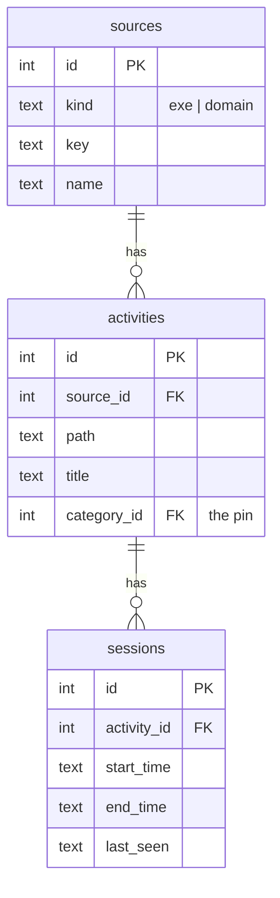
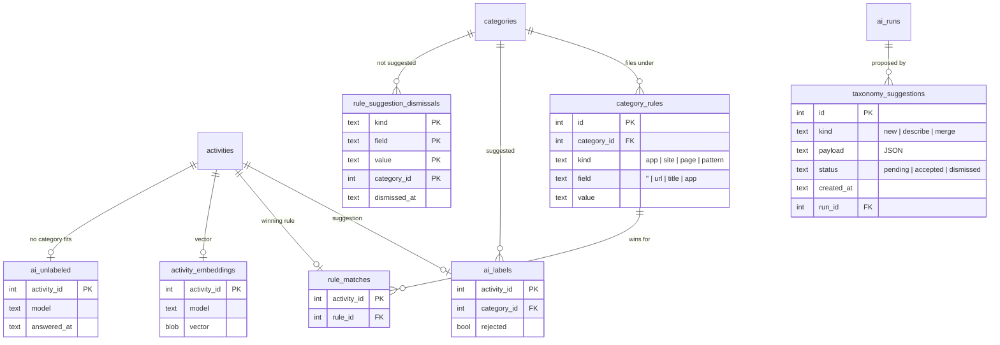
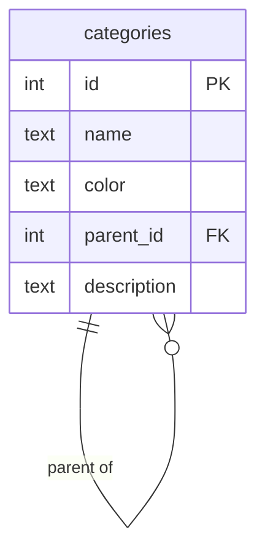

# Persistence

One SQLite file, `makora.sqlite`, in the app-data directory (`AppPaths`, `crates/makora-core/src/paths.rs`). Migrations are in `crates/makora-core/src/db/migrations/` and applied by `db/migrate.rs`; `db/schema.rs` is the hand-written Diesel schema after the latest one. Back up the database before applying a new migration.

Each table belongs to one context. Others may read it, but only the owner writes it.

| Table                 | Owner           | Holds                                                           |
| --------------------- | --------------- | --------------------------------------------------------------- |
| `sources`             | Tracking        | Apps and domains                                                |
| `activities`          | Tracking (row), Categorization (`category_id`, the pin) | One thing done in a source          |
| `sessions`            | Tracking        | Time blocks on an activity                                      |
| `categories`          | Taxonomy        | The category tree                                               |
| `category_rules`      | Categorization  | The person's rules                                              |
| `rule_matches`        | Categorization  | The winning rule per activity                                   |
| `ai_labels`           | Categorization  | The model's suggestion per activity, and whether it was rejected |
| `activity_embeddings` | Categorization  | One vector per activity, tagged with the model that made it     |
| `ai_runs`             | Categorization  | One record per AI run                                           |
| `ai_unlabeled`        | Categorization  | Activities the model found no category for                      |
| `taxonomy_suggestions`| Categorization  | Proposed new categories, descriptions and merges                |
| `activity_category`   | Categorization (view) | The resolved category, read by Reporting                  |

## Tracking tables



## Categorization tables



`rule_suggestion_dismissals` holds the rule suggestions the user dismissed, one per (matcher, category). They cascade with the category.

`ai_runs` holds the trigger, provider, model, status, timestamps, counts, tokens and timings of each run.

`ai_unlabeled` holds the activities the model answered "None" for. `ai_labels` only holds categories the model picked, so this is what tells a "None" answer from an activity never asked about. `ClassificationSvc::assign_ai` writes a row; `store::save_changes` deletes it once the activity has a pin or an active suggestion; a reset clears the table, and the row cascades with its activity.

`taxonomy_suggestions` holds the changes to the taxonomy proposed from the data. `payload` is JSON whose shape depends on `kind` (`domain/suggestions.rs`); a "new category" payload lists its member activity ids, so it is checked against `ai_unlabeled` when read rather than kept in step by foreign keys. `run_id` is the run that proposed it, `NULL` once that run's record is gone.

## Taxonomy table



## The `activity_category` view

The view is the published language between Categorization and Reporting: the precedence rules written once in SQL.

```sql
SELECT a.id AS activity_id,
       COALESCE(a.category_id, r.category_id, l.category_id) AS category_id,
       CASE WHEN a.category_id IS NOT NULL THEN 'manual'
            WHEN r.id IS NOT NULL THEN 'rule'
            ELSE 'ai' END AS source,
       CASE WHEN a.category_id IS NULL THEN r.id END AS rule_id
FROM activities a
LEFT JOIN rule_matches m ON m.activity_id = a.id
LEFT JOIN category_rules r ON r.id = m.rule_id
LEFT JOIN ai_labels l ON l.activity_id = a.id AND l.rejected = 0
WHERE a.category_id IS NOT NULL OR r.id IS NOT NULL OR l.activity_id IS NOT NULL;
```

An activity with no row in the view is uncategorized.

## Transactions

Each application service does one use case in one transaction, so the database never shows half a change:

- Opening, closing or retitling a session, including matching a new activity against the rules and carrying a pin across.
- Creating, editing or deleting a rule, including rewriting `rule_matches`.
- Deleting a category branch, including releasing its pins and AI labels.
- Pinning, unpinning, accepting, and undoing an assignment.

Writes go through `Db::write`, reads through `Db::read` (`db/mod.rs`).
