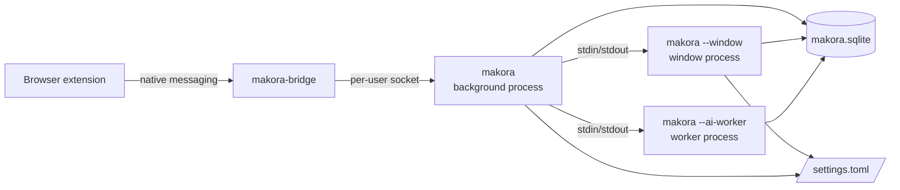
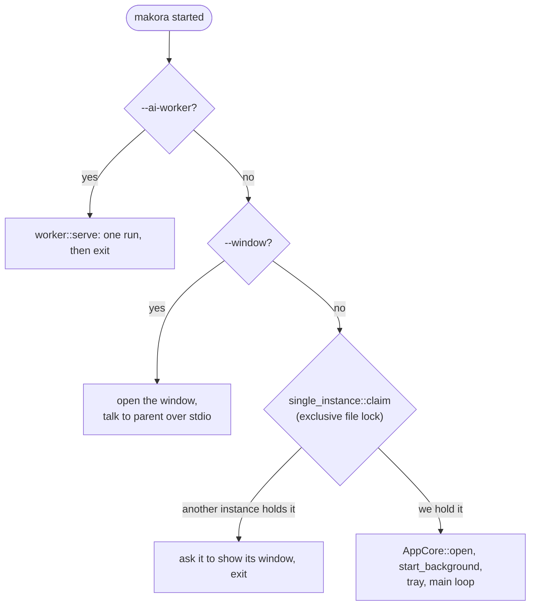
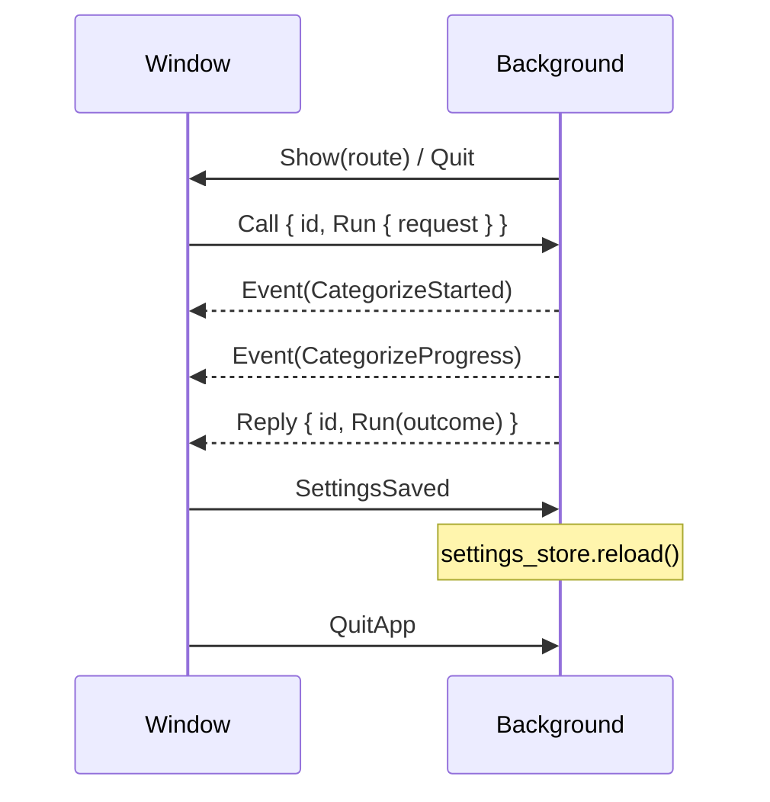
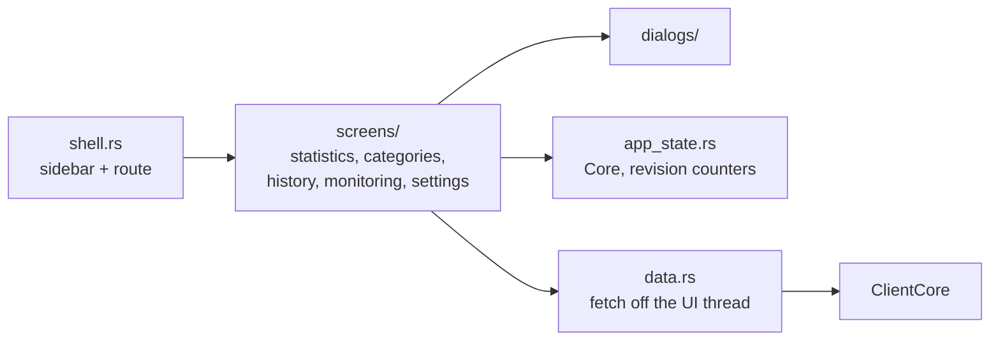

# Processes and IPC

The domain runs in up to four kinds of process. All of them are the same `makora` binary started with different flags (`crates/makora/src/lib.rs`), except the bridge. Splitting by process keeps memory low while the app only tracks: GPUI, fonts, llama.cpp and the GPU driver are only loaded while they are in use.

| Process      | Builds                     | Runs                                                                 | Lifetime                       |
| ------------ | -------------------------- | -------------------------------------------------------------------- | ------------------------------ |
| Background   | `AppCore`                  | Tracker, presence and focus watchers, bridge listener, tray, notifications, AI schedule, model downloads | Login to quit                  |
| Window       | `Services` + `ClientCore`  | The GPUI window; reads and writes SQLite and `settings.toml` itself  | Until the window closes        |
| AI worker    | `Services`                 | One `AiRunState::run` with the local or remote models                | One run                        |
| Bridge       | nothing from the core      | Relays tab messages from the browser to the background process       | As long as the browser keeps it |

## Startup

Process-wide state is built only after the single-instance check, because a second launch exits there. The `--window` and `--ai-worker` children skip the check.

## Window ↔ background

`crates/makora-core/src/ipc/window.rs`. Messages are JSON in length-prefixed frames, the same framing the bridge uses.

The window reads and writes the database and the settings file itself. It only asks the background process for what must outlive it or must not run twice: AI runs and model downloads. On the window side, `RemoteRunner` and `RemoteDownloads` implement `CategorizationRunner` and `ModelDownloads` by sending a `Call`, so `ClientCore` looks the same to the UI in either process.

| `Call`                          | `Reply`                       |
| ------------------------------- | ----------------------------- |
| `Run { request }`, `CancelRun`, `RunStatus` | `Run(Result<AiRunOutcome, RunFailure>)`, `RunStatus`, `Done` |
| `Download { model }`, `CancelDownload`, `DownloadStatus` | `Download(Result<bool, DownloadFailure>)`, `DownloadStatus`, `Done` |

## Background ↔ worker

`crates/makora-core/src/ipc/worker.rs`. `WorkerRunner` is the background process's `CategorizationRunner`: it starts `makora --ai-worker`, tells it what to run in a first `ToWorker::Start { request, trigger }` on its stdin (a scoped run's activity ids would not fit a command line), relays the worker's progress as `CoreEvent`s, and returns its outcome. A later `ToWorker::Cancel`, or stdin closing, stops the run. When the run ends the process exits, and the models, llama.cpp and the GPU driver go with it.

## Integration events

`CoreEvent` (`events.rs`) is the one event type that crosses from the core to a front end:

| Event                                   | Meaning                         |
| --------------------------------------- | ------------------------------- |
| `CategorizeStarted`, `CategorizeProgress`, `CategorizeFinished` | An AI run's progress |
| `DownloadProgress`, `DownloadFinished`  | A model download's progress     |
| `Navigate(NavTarget)`                   | A notification was clicked      |

The front end supplies the `EventSink`. The background process forwards events to the window process if one is open, and shows a notification when a scheduled run labeled something.

## UI

`crates/makora/src/ui/` is a presentation layer over `ClientCore`. It holds no domain logic.

- A `Route` names a screen and, for some, a tab or filters.
- `data::fetch` runs a core call on a background thread and applies the result on the UI thread; dropping the task cancels a stale load.
- Screens watch revision counters in `app_state.rs` to know when to reload after a write.
