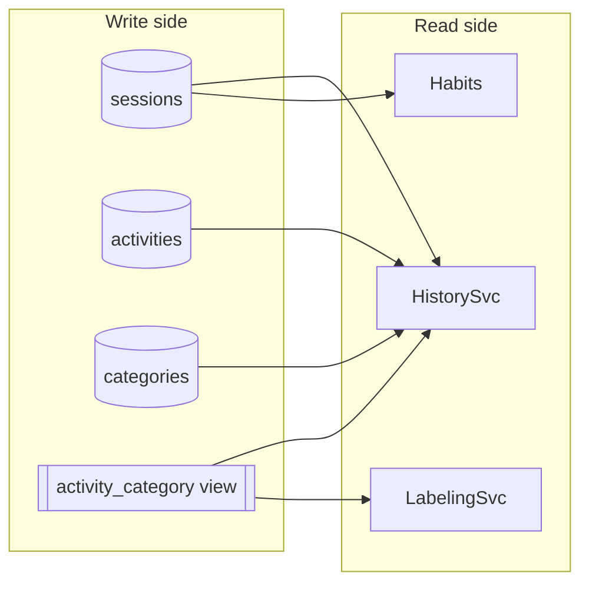

# Reporting context

`crates/makora-core/src/reporting/` (SQL), `crates/makora-core/src/domain/` (read-model services)

Reporting answers questions about what the other contexts recorded: where the time went, when the person works, what still needs review. It **never writes**. In DDD terms it is the query side of a CQRS split: the write models are the aggregates in Tracking, Categorization and Taxonomy; the read models here are shaped for screens.

## Read models

| Service (`domain/`)       | SQL (`reporting/`)  | Screen                               | Answers                                                     |
| ------------------------- | ------------------- | ------------------------------------ | ----------------------------------------------------------- |
| `HistorySvc`              | `history.rs`        | History, Statistics                  | Sessions page by page; time per category, per app, per day  |
| `habits.rs`               | (over sessions)     | Statistics → habits                  | Day profiles, an hour-by-weekday table, observations        |
| `LabelingSvc`             | `review.rs`         | Categories → review                  | Activities to label, the review queue, feedback counts      |
| `RuleSvc` (preview)       | `rules.rs`          | Rule dialog                          | What a draft rule would match                               |
| `AiUsageSvc`              | (over `ai_runs`)    | Insights → usage                     | Tokens, timings and cost per run and model                  |

## Rules the read side follows

- **The category is never re-derived.** Every query joins `activity_category`, the SQL form of the precedence in [Categorization](categorization.md). Its `source` column (`manual`, `rule`, `ai`) says which decision won.
- **The review queue is a view, not a table.** An activity is pending review exactly when its resolved category came from the model (`ac.source = 'ai'`).
- **Hand-written SQL, typed results.** Aggregates, computed joins and `GROUP BY … HAVING` stay in `reporting/` as SQL; the services in `domain/` decide which rows to ask for and turn them into the types in `domain/types.rs`.
- **Scopes and windows are value objects.** `CategoryScope` expands a category to its subtree; `Window` bounds a query in time.
- **A working day runs 04:00 to 04:00 local time**, so work past midnight belongs to the evening before (`habits.rs`).
