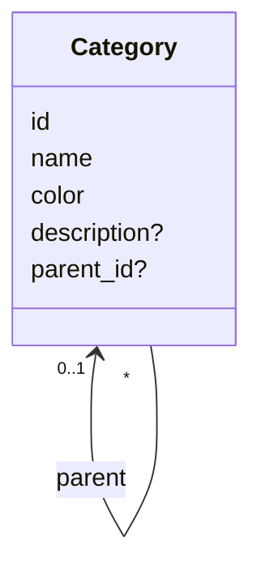
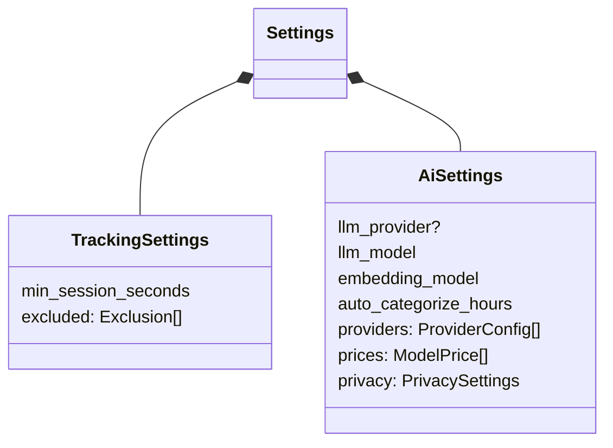

# Supporting contexts: Taxonomy and Settings

## Taxonomy

`crates/makora-core/src/taxonomy/`

The taxonomy is the tree of categories time is filed under. It is small, but other contexts depend on its shape: categorization offers the model the category paths to pick from (`Work > Meetings`), and reporting rolls time up the tree.

| Module            | Layer       | Contents                                                       |
| ----------------- | ----------- | -------------------------------------------------------------- |
| `domain.rs`       | Domain      | `CategoryTree`: descendants, deletion order, cycle checks      |
| `error.rs`        | Domain      | `TaxonomyError`, the invariant violations                      |
| `application.rs`  | Application | `CategorySvc`, `SqliteCategories`                              |
| `store.rs`        | Adapter     | Loading the tree                                               |

The tree as a whole is the aggregate; `CategoryTree` checks every change against it:

| Invariant                                                           | Error                                          |
| ------------------------------------------------------------------- | ---------------------------------------------- |
| A name is unique among its siblings (not across the tree)           | `TopLevelNameTaken`, `SubcategoryNameTaken`    |
| A parent must exist                                                 | `ParentMissing`                                |
| A category cannot move under itself or one of its descendants       | `Cycle`                                        |
| A name must be valid                                                | `InvalidName`                                  |

Deleting a category deletes its whole branch. In the same transaction, `categorization::store::release_categories` removes the pins and AI labels pointing into it, so no activity is left filed under a category that no longer exists.

## Settings

`crates/makora-core/src/settings.rs`, `crates/makora-core/src/settings/application.rs`

Settings are the person's preferences, kept in `settings.toml` in the config directory. The file is the source of truth and can be edited by hand.

- **`SettingsStore`** (`TomlSettings`) is the repository: load, save, reload.
- **`SettingsSvc`** is the application service the settings page calls. Each setter validates, saves, logs, and passes the change on to what depends on it: changing `auto_categorize_hours` reschedules the AI run.
- **`ProviderSvc`** (`ai/providers.rs`) keeps a remote provider's settings entry and its API key in the OS keychain in step. The key never touches `settings.toml`.

Who reads which setting:

| Setting                          | Read by                                              |
| -------------------------------- | ---------------------------------------------------- |
| `tracking.min_session_seconds`   | Tracking: `SqliteSessionRecorder` (noise threshold)  |
| `tracking.excluded`              | Tracking: `SettingsExclusions`                       |
| `ai.llm_*`, `ai.embedding_model` | Categorization: the runner builds the run's models   |
| `ai.auto_categorize_hours`       | Categorization: `ScheduledCategorization`            |
| `ai.providers`, `ai.privacy`     | `ai/`: `LlmRouter`, `Redactor`                       |
| `ai.prices`                      | UI: the AI cost chart                                |

The window process writes the file itself and then sends `SettingsSaved`; the background process reloads it. Hand edits made while the app runs apply on the next launch.
