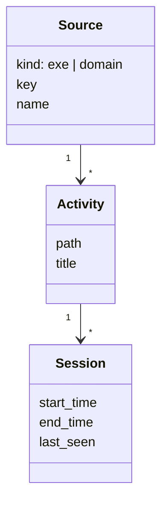
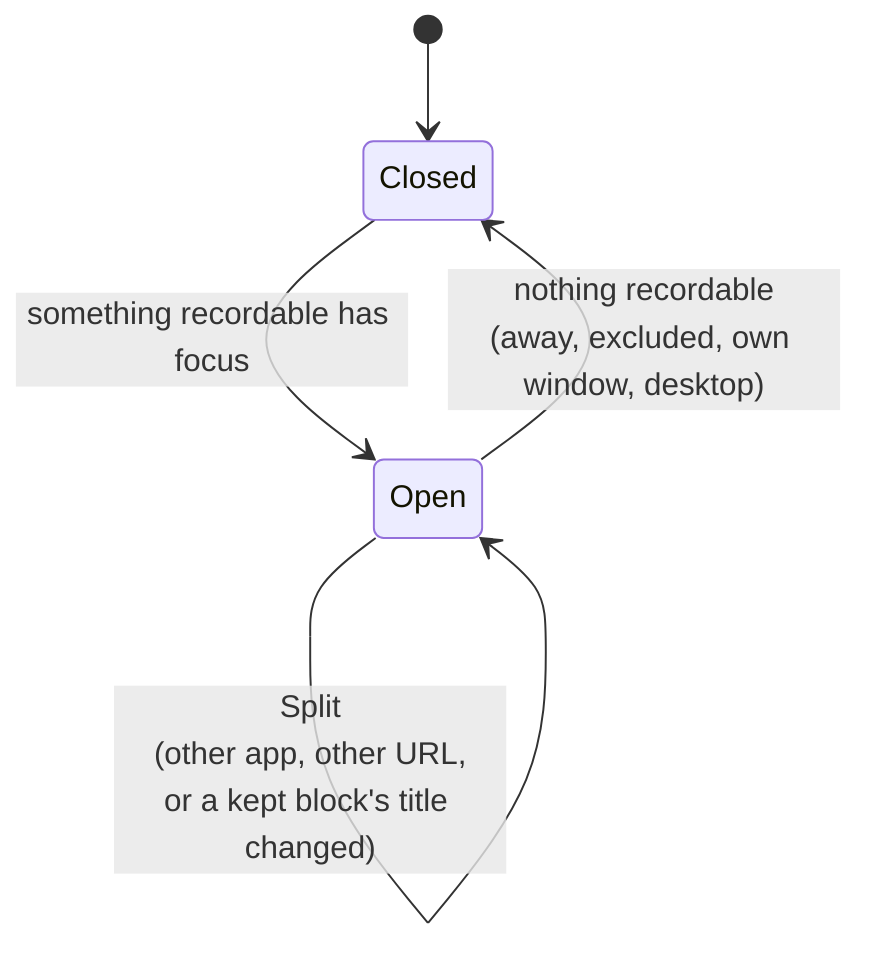
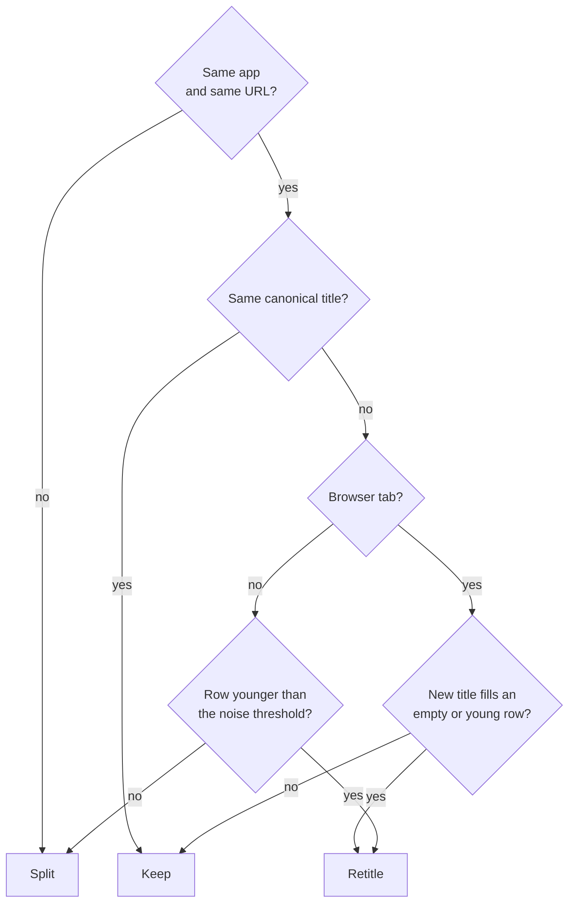
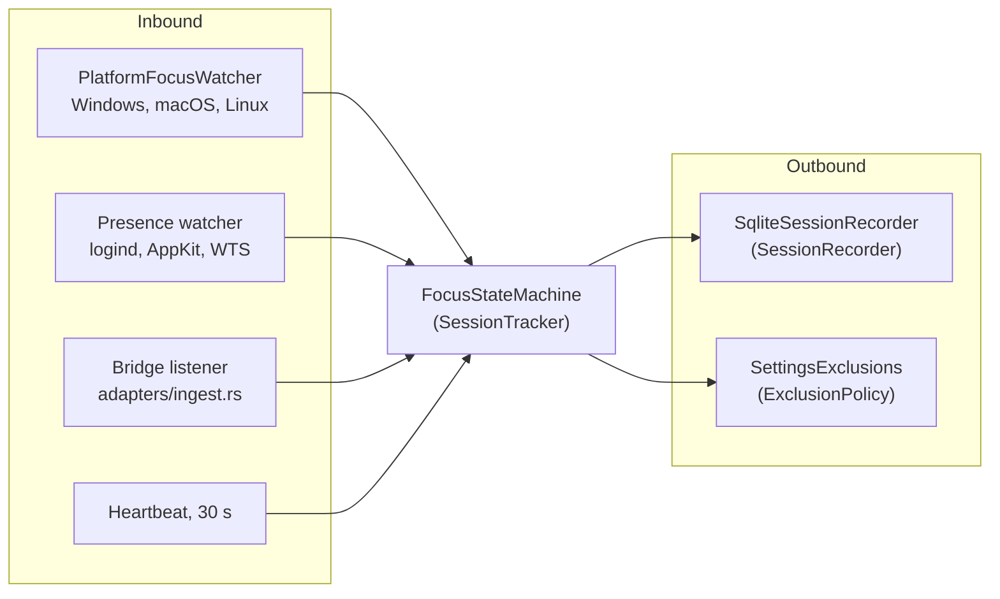
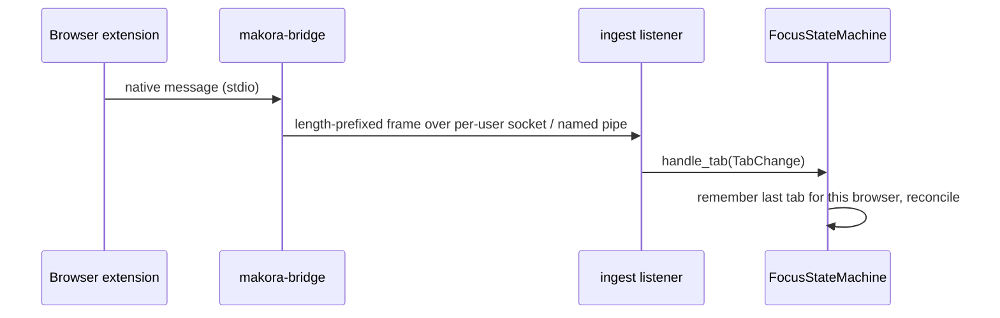

# Tracking context

`crates/makora-core/src/tracking/`

Tracking turns a stream of "this app now has focus" notices into a clean history of sessions. It decides what counts as the same activity, what is too short to keep, and when the person is away. It knows nothing about categories, except that a new activity must be matched against the rules.

## Module layout

| Module                         | Layer        | Contents                                                                                   |
| ------------------------------ | ------------ | ------------------------------------------------------------------------------------------ |
| `domain/events.rs`             | Domain       | `FocusChange`, `TabChange`, `PresenceChange`, `FocusedApp`, `BrowserKind`                  |
| `domain/focus_machine.rs`      | Domain       | `FocusStateMachine`, the aggregate root that owns the open row                             |
| `domain/session_policy.rs`     | Domain       | Noise threshold, merge gap, ignored apps, settling dangling rows                           |
| `domain/source_key.rs`         | Domain       | `SourceKey`, URL normalization (domain, path, canonical tab URL)                           |
| `domain/title.rs`              | Domain       | `canonical_title`: placeholder titles count as empty                                       |
| `domain/exclusion.rs`          | Domain       | `Exclusion`, `ExclusionSet`                                                                |
| `ports.rs`                     | Ports        | `SessionTracker`, `SessionRecorder`, `ExclusionPolicy`                                     |
| `application.rs`               | Application  | `SqliteSessionRecorder`, `SettingsExclusions`                                              |
| `store.rs`                     | Adapter      | `ensure_source`, `ensure_activity`, `prune_orphans`                                        |
| `adapters/`                    | Adapter      | OS focus and presence watchers, the browser bridge listener, native-host registration     |

## Model

- **Source** and **Activity** are entities identified by their natural key: `(kind, key)` and `(source, path, title)`. `ensure_source` and `ensure_activity` find or create them, so the same page visited twice is one activity with two sessions.
- **Session** is an entity with an id. Only the tracker opens and closes sessions.
- **`SourceKey`**, **`FocusedApp`**, **`Exclusion`** and the canonical title are value objects: compared by value, never changed in place.

## The aggregate: `FocusStateMachine`

The state machine is the only writer of sessions and enforces the invariant that **at most one row is open at any time**. It holds what has focus (`Current`), what the open row was recorded against (`Recorded`), whether the person is present, and the last tab each browser reported.

Every input goes through one method, `reconcile`, which compares the open row with what should be recorded and takes one step.

What "should be recorded" (`wanted`) means:

1. The person is present (unlocked, awake).
2. Something has focus that is not an ignored app (`explorer.exe`, `gnome-shell`) or Makora's own window.
3. A browser tab has a domain. A new-tab or settings page is not recorded.
4. No exclusion matches the app, title or URL. Exclusions are asked each time, so an edit applies to the next block.

How an open row follows a change (`step_for_change`):

A tab is one block per page: its title only fills in a placeholder. A window whose title settles a moment after it opens loses no time, because a young row is retitled rather than split.

## Policies

`session_policy.rs` holds the rules every other part of tracking obeys:

| Policy                       | Rule                                                                                         |
| ---------------------------- | -------------------------------------------------------------------------------------------- |
| `is_noise`                   | A block shorter than `min_session_seconds` (1–300 s, default 5) is deleted when it ends.     |
| `should_merge`               | A block resuming within 2 s of closing reopens the old session.                              |
| `is_ignored_app`             | Shell and desktop processes are never recorded.                                              |
| `settle_dangling`            | A session left open by a crash is closed at its `last_seen`.                                 |

Time never runs backwards: events from several sources are stamped when they were seen, and the machine's clock takes the latest.

## Ports and adapters

- **Inbound port `SessionTracker`**: `handle_focus`, `handle_tab`, `handle_presence`, `heartbeat`, `close_current`. `AppCore::start_background` feeds it from one channel on the `makora-activity-tracker` thread.
- **Outbound port `SessionRecorder`**: `start`, `end`, `retitle`, `touch`, `close_dangling`. `SqliteSessionRecorder` does each in one transaction, applying the noise and merge policies.
- **Outbound port `ExclusionPolicy`**: `SettingsExclusions` reads `tracking.excluded` from the settings store.

### Platform adapters

| Platform | Focus                                                                                                  | Presence                               |
| -------- | ------------------------------------------------------------------------------------------------------ | -------------------------------------- |
| Windows  | `SetWinEventHook` on `EVENT_SYSTEM_FOREGROUND`                                                         | `WTSRegisterSessionNotification`, `WM_POWERBROADCAST` |
| macOS    | `NSWorkspaceDidActivateApplicationNotification` (titles need Accessibility)                             | Workspace sleep and lock notifications |
| Linux    | GNOME Shell extension over D-Bus (`gnome.rs`), wlroots `zwlr_foreign_toplevel` (`wlr.rs`), `/proc` for the executable | systemd-logind `LockedHint`   |

### Browser tabs

The extension only reports on change, so the machine keeps the last tab per browser and uses it when that browser regains focus. Without the bridge, browsers are tracked as plain apps. `native_host::register` writes the native-messaging manifests on every start, pointing at the `makora-bridge` next to the running executable.

## Integration with Categorization

Two calls cross into the categorization context, both inside the recorder's transaction:

- `store::ensure_activity` calls `categorization::rules_store::match_new` for a newly created activity, so it is filed by a rule from the first second.
- `SqliteSessionRecorder::retitle` moves the open session to another activity and carries the old activity's pin with `ActivityClassification::carry_pin_into`. The target's own pin wins.
