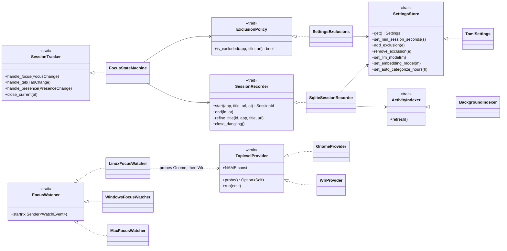
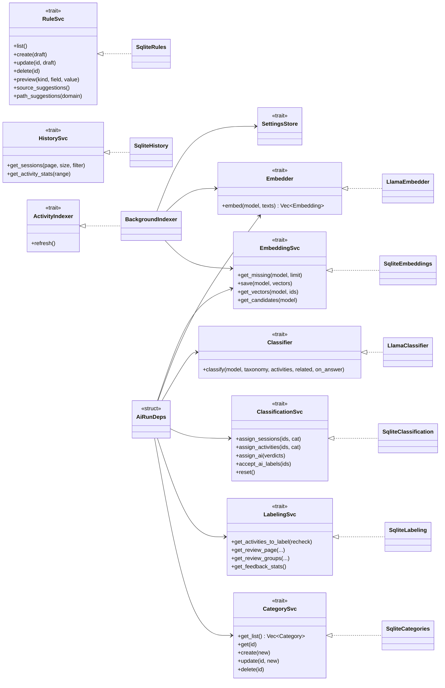
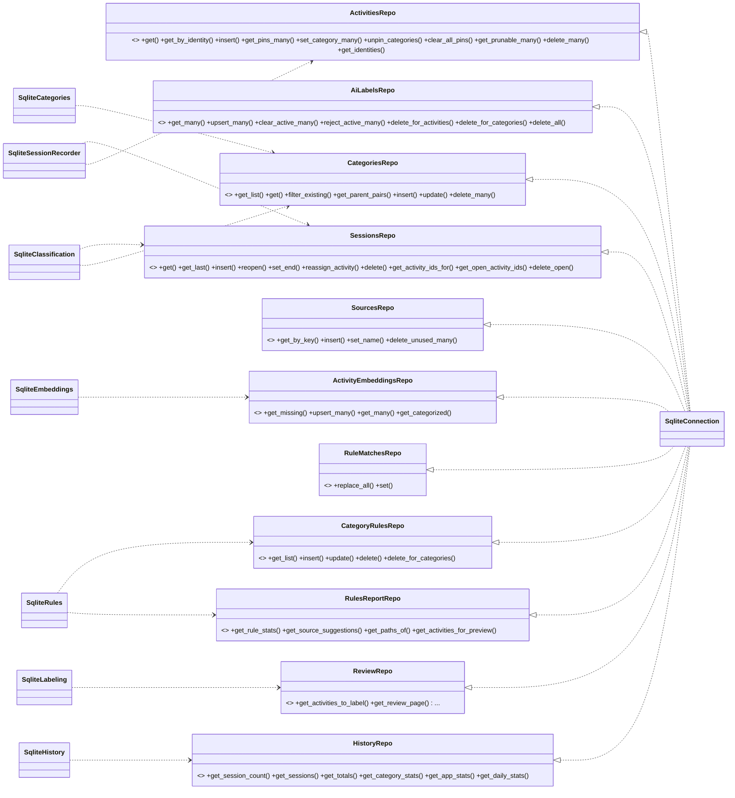

# Trait class diagrams

Traits in `src-tauri/src`, their implementers (`..|>`) and their dependents (`-->` holds an `Arc`/`Box<dyn …>`, `..>` calls or takes it as a parameter). Split by layer.

## 1. Tracking

## 2. Application services and AI ports

## 3. DB repository traits

All implemented by `SqliteConnection`. The `Sqlite*` services take a connection from `Db` and call the repo traits on it.

## Notes

- Repo-trait edges come from which files mention each trait. `SqliteClassification`, `SqliteRules` and `SqliteSessionRecorder` also reach `ActivitiesRepo`, `AiLabelsRepo`, `CategoryRulesRepo`, `RuleMatchesRepo` and `SourcesRepo` through the helper modules (`categorization/store.rs`, `categorization/rules_store.rs`, `tracking/store.rs`), which are omitted.
- `lib.rs` builds everything inside `setup` and registers services with `app.manage(Box<dyn …>)`; `host/commands/*` take them as `State<Box<dyn …>>`. That layer is omitted.
